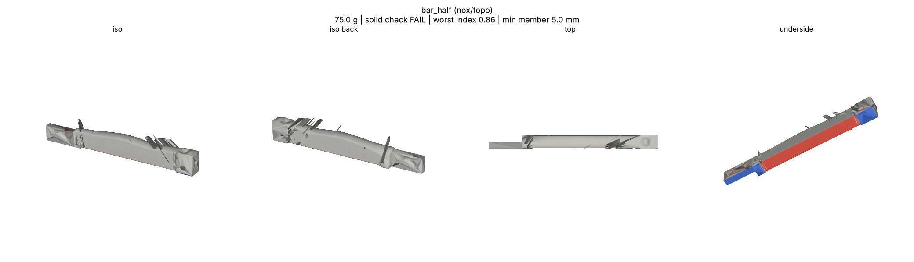

bar_half organic-v1: solid_check FAIL, result FAILED (engine test run, not saved to print/)

Organic finish (default), gen 45 cm3, h 1.0. Run PID 360, peak memory sampled from ps RSS of the process tree (engine reports 4.60 GB).

| Item | Value |
|---|---|
| Mass | 74.98 g (M), drawn 16.68 g; v8 77.58 g (-2.60 g); topo-v3 71.23 g |
| Worst index, same grid (topo.compare) | 0.859 in 'box on one tip 50 N up' at (21.5, 53.5, -181.5); v8 0.929 at (21.5, 51.5, -180.5); topo-v3 0.804 |
| Solid check | FAIL: 777 plain bodies, 2 eroded bodies (42,775 and 56.1 mm3), 3 necks (1.8 mm under at 135.7,52.6,-181.0 blob 56 mm3; two at 3.0 mm), 4 thin walls (1.0 to 1.66 mm), 23 acute edges, drawn_not_in_main none |
| Function check | not ok: skin_missing 10.19 mm3, in_cuts 23.79 mm3, outside_env 0 |
| Bodies after build | 3 (16 shells, 12 specks dropped, sealed cavity 2517.75 mm3 kept) |
| Iterations | 89 (stopped: max_stage) |
| Wall time | 1212 s total (layout 1108 s, build 104 s) |
| Peak memory | 4.60 GB |

solid_check output (exact):

    runs/bar_half/organic-v1/bar_half.stl FAIL {'bodies_plain': 777, 'bodies_eroded': 2, 'eroded_volumes_mm3': [42775.0, 56.1], 'necks': [{'neck_under_mm': 1.8, 'blob_thick_mm': 3.5, 'joint_mm2': 38.7, 'blob_mm3': 56.1, 'at': [135.7, 52.6, -181.0]}, {'neck_under_mm': 3.0, 'blob_thick_mm': 11.6, 'joint_mm2': 140.8, 'blob_mm3': 3827.9, 'at': [11.6, 51.4, -191.1]}, {'neck_under_mm': 3.0, 'blob_thick_mm': 12.0, 'joint_mm2': 312.8, 'blob_mm3': 4277.5, 'at': [172.7, 54.0, -187.2]}], 'drawn_not_in_main': [], 'thin_walls': [{'kind': 'wall', 'thick_mm': 1.66, 'core_mm3': 35.53, 'at': [166.7, 46.9, -193.4], 'span': [5.8, 1.4, 0.4]}, {'kind': 'wall', 'thick_mm': 1.5, 'core_mm3': 17.97, 'at': [159.7, 60.9, -186.1], 'span': [5.8, 0.8, 0.2]}, {'kind': 'wall', 'thick_mm': 1.41, 'core_mm3': 13.91, 'at': [28.5, 59.7, -186.9], 'span': [3.9, 1.0, 0.2]}, {'kind': 'wall', 'thick_mm': 1.0, 'core_mm3': 4.89, 'at': [146.2, 53.9, -196.5], 'span': [3.1, 0.9, 0.4]}], 'acute_edges': 23, 'ok': False}

